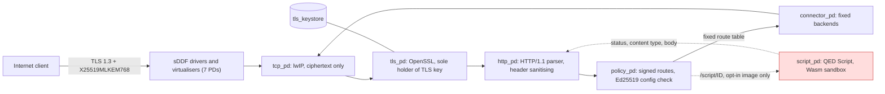

# QEDOS

**The Proof-Oriented Web OS**

*Don't trust the code. Verify what it can do.*(コードを信用せず、そのコードに何ができるかを検証する)

AI が人間の監査より速くコードを書く世界のために。


[English](README.md) | 日本語

QEDOS は、seL4 と Microkit の上に作った、実験的でセキュリティ重視の HTTPS アプライアンス OS です。必須のハイブリッド耐量子鍵交換、ケイパビリティで分離されたコンポーネント、サンドボックス化したサーバーサイド WebAssembly 実行を組み合わせています。アプリケーションコードを信頼できない場合でも、セキュリティ境界を明示的で最小限、かつ機械的に検査できる形にすることが目標です。

従来の OS は、肥大化し複雑化するスタックを守ろうとします。QEDOS は逆の方向を探ります。必要な機能だけに絞り、信頼できないコンポーネントを隔離し、その境界を機械的に検証します。

> **研究段階のプロジェクトです。** QEDOS は第三者による監査を受けておらず、本番利用できるセキュリティ製品ではありません。QEMU 上でしか動かしたことがなく、物理ハードウェアでの実行は一度もありません。何をどう検査し、何を検査していないかは、[Security assurance](#security-assurance) と [Status and limitations](#status-and-limitations) に書いています。

## Contents

- [30 秒でわかる QEDOS](#30-秒でわかる-qedos)
- [Architecture](#architecture)
- [Why AI matters](#why-ai-matters)
- [Why QEDOS?](#why-qedos)
- [What makes QEDOS different?](#what-makes-qedos-different)
- [Security assurance](#security-assurance)
- [QED Script](#qed-script)
- [Quick start](#quick-start)
- [Benchmarks](#benchmarks)
- [Status and limitations](#status-and-limitations)
- [Roadmap](#roadmap)
- [Project layout](#project-layout)
- [Contributing](#contributing)
- [License and acknowledgements](#license-and-acknowledgements)
- [Documentation inconsistencies](#documentation-inconsistencies)

## 30 秒でわかる QEDOS

| 質問 | 答え |
|---|---|
| 何か? | 単機能の HTTPS アプライアンス OS。seL4 マイクロカーネル上の 12 個の隔離コンポーネント(オプションのスクリプト用コンポーネントを入れると 13 個)で、TLS 終端、固定ルートのリバースプロキシ、署名付き WebAssembly ハンドラ(オプション)を提供します。 |
| なぜ作るのか? | アプリケーションコードを一切信頼しない OS が作れるかを試すためです。コンポーネントごとの権限を最小にし、境界をツールで検査できるようにします。 |
| Linux との違いは? | Linux も堅牢化できますし、耐量子 TLS も使えます。QEDOS は汎用機能を制限するのではなく取り除き、残った境界の機械的な検査を記録しています。成熟度ははるかに低いです(比較表を参照)。 |
| 技術的に面白い点は? | 生成された seL4 システムのケイパビリティグラフ監査、パーサとポリシーのクレートに対する Kani 証明、V8 と差分ファジングした Wasm インタプリタ、IPC テスト用の敵対的 `script_pd` モデル。 |
| 動かせる? | はい。QEMU 上で動きます。macOS でもビルド済みイメージから動かせます: `python3 tests/test_sel4.py`。[Quick start](#quick-start) を参照。 |
| 何が検証済み? | 特定のコンポーネントの特定の性質が、記載したレベルで検査されています。大半は BOUNDED か TESTED で、単一関数に対する PROVEN が少しあります。[保証レベル表](#security-assurance)を参照。 |

## Architecture

論理ビューです。共有メモリのリングや sDDF ドライバ周りの配線は省略しています。デフォルトイメージは **12 個のプロテクションドメイン(PD)** からなります。内訳は sDDF/ドライバ PD が 7 個(`timer_driver`, `serial_driver`, `serial_virt_tx`, `ethernet_driver`, `net_virt_rx`, `net_virt_tx`, `tcp_net_copier`)、QEDOS の PD が 5 個(`tcp_pd`, `tls_pd`, `http_pd`, `policy_pd`, `connector_pd`)です。オプトインの QED Script イメージ(`QEDOS_SCRIPT=1`)は `script_pd` を加えた **13 PD** です。数は `sel4/meta_proofgate.py` と、生成された `build/sel4/proofgate.system`、`build/sel4-script/proofgate.system` から確認しました。



`script_pd` が持つのは、`policy_pd` および `http_pd` との共有メモリ領域 2 つと通知チャネル 2 つだけです。`tls_keystore` のマッピングも、`tls_pd`・`tcp_pd`・`connector_pd`・ドライバへのチャネルも、IRQ や I/O ポートのケイパビリティも持ちません。これは Microkit が生成する成果物に対する静的検査です(`scripts/check-script-caps.py`, `scripts/capgraph.py`)。検査対象はシステムのモデルであり、カーネルについての証明ではありません。

## Why AI matters

AI はソフトウェアセキュリティの両側を変えます。ソフトウェアの生成が大幅に安くなる一方で、脆弱性の発見や攻撃対象の分析も安くなります。コードの書き手を信頼することは、そのコードを実行してよい根拠として、もはや十分ではありません。

QEDOS は、アプリケーションコードが誤動作する、あるいは侵害されることがある、という前提から出発します。コードの権限を制限し、検証するのはコードではなく境界です。これは、そうした世界の実行モデルについての研究プロジェクトであり、AI が生成したコードのデモではありません。AI が安全性を証明したとも主張しません。

このリポジトリでの AI の関与について確認できる事実は次のとおりです。11 コミットのうち 6 つに `Co-Authored-By: Claude` のトレーラーがあります(`git log`)。QED Script、ケイパビリティグラフ、IPC ハードニング、差分ファザーの作業を含みます。この README の検証に関する主張はすべて、記録されたツール実行(Kani、Z3、テスト、ファジングのログ)に基づいており、AI の判断には基づいていません。

## Why QEDOS?

| 考え方 | QEDOS の実装 | 証拠のレベル |
|---|---|---|
| 攻撃面を減らす | イメージにシェルも SSH デーモンも動的な管理エンドポイントもありません。ルートは固定の Ed25519 署名付きテーブルです。現行(デバッグ)ビルドにはデバッグ用シリアルコンソールがあります。 | TESTED(`scripts/check-laws.sh` の静的 grep とコード検査。`LAW_005`, `LAW_010`) |
| 機能ごとに権限を分ける | 機能ごとに seL4/Microkit の PD を 1 つ割り当て。TLS 秘密鍵は `tls_pd` にしかマップされません。 | TESTED(生成された成果物のケイパビリティ監査) |
| 「OS を証明する」のではなく条件を検査する | Kani、Z3、ケイパビリティグラフ検査、ASan ハーネス、テストを、名前を付けた個々の性質に適用します。 | [保証レベル表](#security-assurance)を参照 |
| 耐量子鍵交換 | TLS 1.3 の `X25519MLKEM768` のみ、`TLS_AES_256_GCM_SHA384` のみ。「harvest now, decrypt later」(今は記録だけして後で解読する攻撃)への対策で、将来量子コンピュータが現れても、記録された通信は守られます。 | TESTED(`LAW_002`, `LAW_003`) |
| 信頼できないコードを動かす | 専用 PD 内の署名付き Wasm。燃料とメモリの上限、許可リスト化したホスト API。 | [QED Script](#qed-script) を参照 |

**耐量子の範囲。** 耐量子なのは鍵交換だけです。サーバー認証は古典的で(開発用設定の証明書は ECDSA P-256)、その署名を偽造できる将来の量子攻撃者はサーバーになりすませる可能性があります。ML-DSA 証明書は使っていません。

**スクリプトの安全性と OS の隔離は別です。** スクリプトの安全性とは、Wasm サンドボックスがゲストに許さないことです。OS の隔離とは、完全に侵害された `script_pd` がそれでも到達できる範囲のことで、その範囲はケイパビリティグラフから監査したものであり、証明したものではありません。

## What makes QEDOS different?

Linux でも、強い隔離(namespace、seccomp、SELinux、VM、サンドボックス)や耐量子 TLS(たとえば OpenSSL 3.5 以降、あるいは PQC 対応プロキシ)は設定できます。この表が比べているのは、デフォルトと設計意図であり、他では不可能だという主張ではありません。

| | 汎用 Linux サーバー | Linux 上の従来型リバースプロキシ | QEDOS(本リポジトリ) |
|---|---|---|---|
| 汎用シェル | デフォルトであり(削除は可能) | ホストのものを継承 | イメージ内にはなし。現行ビルドにはデバッグ用シリアルコンソール |
| リモート管理 | 通常は SSH | ホストのもの + 任意の管理 API | なし。設定は署名付きブロブで、変更は新しいイメージ + 再起動 |
| 必須の PQC ハイブリッド鍵交換 | 設定可能 | PQC 対応の TLS ライブラリがあれば設定可能 | 強制(`X25519MLKEM768` のみ)。認証は古典的 |
| ケイパビリティによるコンポーネント分離 | 可能(コンテナ、MAC)。カーネルは共有 | プロセス単位 | seL4 PD。生成されたケイパビリティグラフから監査 |
| サンドボックス化したサーバーサイド実行 | 可能(コンテナ、Wasm ランタイム) | 通常はプロキシプロセス内のモジュール | 専用 PD の署名付き Wasm。ネットワーク権限も鍵の権限もなし |
| 機械的に検査できるセキュリティ性質 | 主にテストと監査 | 同左 | 一部あり(Kani、Z3、ケイパビリティ監査)。部分的 |
| 対応ハードウェア | 非常に広い | 非常に広い | QEMU のみ(x86_64、aarch64 `virt`)。Raspberry Pi 4 イメージはビルドできるが未起動 |
| 運用成熟度 | 数十年、大きなエコシステム | 数十年、本番実績あり | 研究プロトタイプ。監査なし。単一機能のアプライアンス |

## Security assurance

このリポジトリで使うレベル:

| レベル | 意味 |
|---|---|
| PROVEN | 証明器が、記載した対象について、記載した仮定のもとで性質を検査した。実行記録がリポジトリにある。 |
| BOUNDED | 有界モデル検査(Kani)または境界付きの証明。境界を超えた範囲については何も言えない。 |
| TESTED | 自動テスト、ファジング、またはモデルの機械的な監査。試した失敗が起きないことを示すだけ。 |
| DESIGNED | 設計上そう意図している。目視以外の検査はない。 |
| UNVERIFIED | 検査していない、または古い版のコードでしか検査していない。 |

| 性質 | レベル | 証拠と注意点 |
|---|---|---|
| HTTP パーサが範囲内に収まる。HTTP/1.1 + Host を強制(`LAW_006`) | BOUNDED | Kani `pg-http` 8/8 ハーネス(`build/kani/pg-http.log`)。境界は小さい(N=18..20、ヘッダ 2 個) |
| 固定ルートにのみ到達可能。トラバーサルなし(`LAW_001`) | BOUNDED + TESTED | Kani `pg-policy` 3/3(パスは 8 バイトまで)。34 件の HTTP テスト。敵対的プローブ |
| バックエンドは固定テーブルからのみ選択(`LAW_004`) | BOUNDED + TESTED | Kani `pg-policy`、`SEL4_004` |
| Ed25519 署名付き設定のみ適用(`LAW_011`) | BOUNDED + TESTED | Kani `pg-config` 2/2。Ed25519/SHA-512 の実装自体は UNVERIFIED |
| TLS 1.3 + `X25519MLKEM768` のみ(`LAW_002/003`) | TESTED | ホストと seL4 でのテスト。OpenSSL 3.6.1 が正しいことに依存 |
| TLS 鍵が HTTP 層・スクリプト層から到達不能(`LAW_008`, `LAW_018`) | TESTED(静的監査) | ケイパビリティ監査 + イメージのスキャン。Viper の `.vpr` モデルは Microkit が生成し、リポジトリがパターン検査しているだけで、**Viper 自体は一度も実行していません**。したがって Viper で証明したという主張はしません |
| PD ごとの最小ケイパビリティ(`LAW_012`, `LAW_014`) | TESTED(静的監査) | `check-caps.py`、`check-script-caps.py`(弱体化した 9 システムを検出)、`capgraph.py`(`build/sel4-script` で検査 A1-A7、B1、C1-C8 が PASS、D1 のカーネルデバッグ検査は WARN)。検査対象は抽出したモデルで、モデルの忠実性は証明していない |
| この構成で seL4 が隔離を強制する | UNVERIFIED | 仮定。seL4 自身の証明は、この x86_64 Microkit デバッグ構成には主張せず、QEDOS にも転用しない |
| Wasm のメモリ範囲検査 `checked_range`(`LAW_013`) | 1 関数について PROVEN。記録は Phase 3 より前 | Kani(全 `u32` 入力)+ Z3 `range_sound.smt2`。`build/kani/pg-script.log` は Phase 3 のインタプリタ変更より前の日付で、再実行は未了 |
| インタプリタ全体が自分のメモリに閉じ込められる | TESTED | Phase 3 前のインタプリタでの 60,000 プログラムのガードバンド・ファズが記録されている。インタプリタ全体の証明はない。現行ツリーでこのファズを再実行した記録はない |
| Wasm の意味論的適合 | TESTED(差分テスト。証明ではない) | `tests/test_wasm_differential.py` による V8 との比較: seed 2、400,000 ケース、不一致 0。seed 3、200,000 ケース、不一致 0(`build/fuzz/diff-2.json`, `diff-3.json`)。seed 1(100,000 ケース)では不一致が 7 件見つかり(`diff-1.json`)、その後ローダ修正がコミットされた。seed 1 の再実行の記録はない。ジェネレータはサブセットが対象で、浮動小数点や SIMD などは拒否されることだけを確認している |
| ホスト API の閉じ込め(`LAW_015`) | BOUNDED + TESTED | 単一 API ポリシーでの Kani。敵対的インポートモジュール 7 件 |
| リソース上限(`LAW_016`) | TESTED | 証明なし。seL4 では時間の上限は燃料の上限(タイマークライアントなし) |
| 署名済みスクリプトのみ実行(`LAW_020`) | TESTED | ポリシーと wasm のあらゆる 1 バイト反転を拒否。Ed25519/SHA-512 は UNVERIFIED。ロールバック対策なし。開発用鍵をコミット済み |
| スクリプト KV の ACL(`LAW_021`) | BOUNDED | Kani 3 ハーネス(キー境界は極小)+ Z3。認証が存在しないため seL4 上では使えない(KV 呼び出しはすべて拒否) |
| 悪意ある `script_pd` に対する PD 間の共有メモリ IPC | TESTED | ASan/UBSan のホストハーネス `tests/ipc/harness_http.c`、`harness_policy_conn.c`。実際の C グルーコードを Rust をスタブにして実行する。修正前のコードでバグを再現し、`3e77d5d`、`f825d90` で修正。IPC の形式証明はない |
| ハードニング後の seL4 でのエンドツーエンド | TESTED | QEMU TCG で `test_sel4.py` 6/6、`test_script_sel4.py` 9/9(`build/script/sel4-default-hardened.log`, `sel4-hardened-3.log`。ログファイルの日付は 08:41-08:46 で、最終コミット `f825d90`(09:00)より前) |
| Proof-Carrying Script | DESIGNED | エンベロープ形式のみ。チェッカーなし |
| ハードウェア、リリースカーネル、サイドチャネル | UNVERIFIED | 未実施、または明示的に対象外 |

**TCB(信頼される計算基盤)。** プロキシ経路が信頼するもの: ハードウェア、seL4 カーネルバイナリとそのビルド構成、Microkit のツール・モニタ・CapDL イニシャライザ、sDDF ドライバと lwIP、OpenSSL 3.6.1(ML-KEM と X25519 のコードを含む)と freestanding libc shim、PD 内の C グルーコード(`sel4/pds/*.c`)、Rust クレート `pg-http`・`pg-policy`・`pg-config`、`pg-config` の純 Rust による Ed25519/SHA-512、コンパイラとツールチェーン。スクリプトのリクエストではこれに `script_pd`、`pg-script`、`pg-script-policy`、`pg-script-verify`、C-ABI シムが加わります。サードパーティライブラリ、コンパイラ、ハードウェアはここでは検証していません。サイドチャネルは、あらゆる主張の対象外です。

詳細: [docs/SECURITY.md](docs/SECURITY.md), [docs/LAWS.md](docs/LAWS.md), [docs/THREAT_MODEL.md](docs/THREAT_MODEL.md), [docs/CAPABILITY_AUDIT.md](docs/CAPABILITY_AUDIT.md), [docs/STATUS.md](docs/STATUS.md)。

## QED Script

信頼せずに、信頼できないコードを動かします。QED Script は **署名付き WebAssembly** を `script_pd`(アプリケーション PD で最低の優先度)で、`GET|POST /script/<module>` のルート上で実行します。

| 制御 | 内容 | レベル |
|---|---|---|
| ホスト API の許可リスト | モジュール `qs` の 8 関数: `req_method`, `req_field`, `resp_status`, `resp_content_type`, `resp_write`, `kv_get`, `kv_put`, `kv_delete`。WASI、ネットワーク、ファイルシステムはなし。未知のインポートはロード時に拒否。 | BOUNDED + TESTED |
| 上限 | 燃料、線形メモリ、スタック深さ、リクエスト/レスポンスサイズ、ホスト呼び出し回数。署名付きポリシーで指定し、プラットフォームの上限(メモリ 1 MiB、燃料 5e7、ボディ 64 KiB)で頭打ち。 | TESTED |
| 署名付きモジュール | wasm + ポリシー + ランタイム ID + proof ダイジェストへの Ed25519 署名。設定用とは別のコード署名鍵を使用。**開発用シードはコミット済み(`config/keys/qs-code-signing-seed.hex`)。デプロイでは決して信頼しないこと。** | TESTED |
| TLS 鍵なし、ネットワーク権限なし | [Architecture](#architecture) を参照。 | TESTED(監査) |
| エンジン | 専用に作ったインタプリタ(`crates/pg-script`、`no_std`、`forbid(unsafe_code)`、ヒープなし)。WebAssembly のサブセット。現行ツリーは i32/i64、グローバル、テーブルと `call_indirect`、`br_table`、`memory.grow`、バルクのコピー/フィルに対応。浮動小数点、SIMD、スレッド、WASI、マルチバリューは拒否。Rust/TinyGo の SDK はまだない。 | 保証レベル表を参照 |

**Hello World**。`examples/hello/build.py` より(`tools/qswasm.py` でアセンブル。Wasm ツールチェーンは不要):

```python
BODY = b'{"message":"Hello from QEDOS"}'
m = Module(memory_pages=1)
m.import_func("resp_status", 1, 0)
m.import_func("resp_content_type", 1, 0)
m.import_func("resp_write", 2, 0)
m.data.append((0, BODY))
m.func("handle", 0, 1, 0, f"""
i32.const 200
call $resp_status
i32.const 0          ;; application/json
call $resp_content_type
i32.const 0
i32.const {len(BODY)}
call $resp_write
i32.const 0
end
""", export="handle")
```

署名付きポリシーは `examples/hello/app.policy` です(`allow = resp_status`, `allow = resp_content_type`, `allow = resp_write`, `max_fuel = 10000`, `max_memory_bytes = 65536`, ...)。実行方法は [Quick start](#quick-start) の `qs` CLI を参照してください。

### Proof-Carrying Script

| 現在あるもの | 研究目標(未実装) |
|---|---|
| `app.proof` エンベロープ(`QSPF1`)を解析し、正確な wasm とポリシーのバイト列に束縛する。その SHA-512 は署名の対象。`proof_accepted()` は定数 `false` で、受理モードは `SignedSandboxed` のみ。proof がコードを実行する理由や上限を緩める理由になることはない。 | 小さく独立した証明チェッカー、`FuelBounded`・`HostApiSubset`・`MemorySafe` などの主張のための証明書形式、チェッカーの Wasm 意味論とインタプリタの機械化された対応付け。設計メモ: [docs/SCRIPT_VERIFICATION.md](docs/SCRIPT_VERIFICATION.md)。 |

詳細: [docs/QED_SCRIPT.md](docs/QED_SCRIPT.md), [docs/SCRIPT_SECURITY.md](docs/SCRIPT_SECURITY.md), [docs/SCRIPT_RESULTS.md](docs/SCRIPT_RESULTS.md)。

## Quick start

「5 分」は、前提条件が揃ったマシンでビルド済みイメージを使う場合の目標で、測定した保証ではありません。これらの手順を macOS(Apple Silicon)で実行した記録は [docs/TEST_REPORT.md](docs/TEST_REPORT.md) にあります。記録された Linux での実行では、QEMU の起動に約 10 秒かかりました。

**前提条件:** `git`、`python3`、QEMU(`qemu-system-x86_64`)、Rust(`cargo`)、バージョン 3.5 以降の OpenSSL コマンドラインクライアント(クライアント側で `X25519MLKEM768` を使うために必要。OpenSSL 3.0.x にリンクされた Python の `ssl` では使えません)。

```sh
brew install qemu openssl@3 rust
git clone https://github.com/shi3z/qedos.git && cd qedos

# Boot the prebuilt 12-PD image in QEMU and run the 6 end-to-end PQC HTTPS tests
python3 tests/test_sel4.py

# Run a QED Script example on the host (pure Rust, no seL4)
scripts/qs-ws.sh build --release -p pg-script-cli
build/qs/ws/target/release/qs run examples/hello      # prints status/body: {"message":"Hello from QEDOS"}

# Verify the negotiated post-quantum key exchange: boot with tools/run-echo.sh, then
OPENSSL_CONF=config/openssl-min.cnf openssl s_client -connect 127.0.0.1:18443 -tls1_3 -groups X25519MLKEM768
# expect: Negotiated TLS1.3 group: X25519MLKEM768
```

コミット済みのビルド済みイメージはデフォルトの 12 PD 版です。seL4 上で 13 PD の QED Script イメージを動かすには、Linux でのフルツールチェーンのビルドが必要です。正確な起動コマンド、ソースからのフルビルド、全テスト・検証スイート、aarch64 は **[docs/BUILD.md](docs/BUILD.md)** にあります。

## Benchmarks

`docs/RESULTS.md` と `docs/SCRIPT_RESULTS.md` に記録された数値のみを載せています。マシンも実行も異なるため、直接は比較できません。Wasm のマイクロベンチマークは Phase 3 のインタプリタより前のもので、再測定していません。

### Host Reference Implementation(Linux の `pg-proxy`。seL4 ではない)

環境(`docs/RESULTS.md`): 24 コアの Linux ホスト、ループバック、クライアント + プロキシ + バックエンドが同一マシン、シングルスレッドのプロキシ、OpenSSL 3.6.1。

| テスト | 結果 |
|---|---|
| PERF_001/002: 10,000 本の TCP / TLS 1.3 `X25519MLKEM768` 接続を保持 | 失敗 0。RSS 9.6 MB(TCP)、TLS 接続あたり約 27.8 KB(ピーク 285 MB) |
| PERF_004: 10 % アクティブ、20 秒 | 約 13.4 k req/s、エラー 0 |
| PERF_006: ハンドシェイクストーム | 1 コアで約 5.4 k ハンドシェイク/秒 |

後日の再実行(`docs/SCRIPT_RESULTS.md`。QED Script の作業に使ったマシン。上の数値は別のハードウェアで取ったと注記されている)では、PERF_004 が 8.2 k req/s、PERF_006 が 2.6 k ハンドシェイク/秒でした。PERF_008 は、Python のテストクライアントが PQC グループを使えず、実行できませんでした。負荷ツールのレイテンシ百分位は log2 バケットの上限値で、クライアントが CPU を共有しています。

**ホスト上の Wasm マイクロベンチマーク**(HTTPS ではない。`qs bench`、リリースビルド、1 スレッド、TLS・ネットワークなし。24 コア x86-64 Linux ホスト、`docs/SCRIPT_RESULTS.md`): Hello World 180,322 req/s(5.6 us、燃料 9)、KV カウンタ 174,669 req/s、1000 バイトボディの JSON エコー 2,681 req/s(373 us、燃料 62,229)。プロキシの req/s とは比較できません。

### QEMU seL4 Implementation(QEMU TCG エミュレーション、KVM なし)

環境: Ubuntu 22.04 ホスト。新しい PQ-TLS ハンドシェイクを毎回行うエンドツーエンドの HTTPS リクエストを 30 回連続で実行し、それを 2 回(`docs/SCRIPT_RESULTS.md`, `build/script/sel4-latency.jsonl`)。エミュレータ律速で、ハードウェアの速度は何も示しません。

| リクエスト | 中央値レイテンシ |
|---|---|
| `GET /health`(デフォルトイメージ) | 83.0 / 82.7 ms |
| `GET /health`(script イメージ) | 82.8 / 82.4 ms |
| `GET /script/hello` | 83.2 / 84.1 ms |
| `POST /script/json-echo`(500 バイトボディ) | 85.0 / 88.0 ms |

起動から準備完了まで: 10.3-10.8 秒(デフォルト)、11.3 秒(script イメージ)。

### Native Hardware

**測定なし。** 物理ハードウェアでの実行は一度も行っていません。

## Status and limitations

| 領域 | 現状 |
|---|---|
| ハードウェア | 物理ハードウェアでの実行なし。Raspberry Pi 4 イメージはビルドでき、ケイパビリティ監査にも通るが、起動したことはない。ベアメタルの x86 起動経路もない([docs/X86_BAREMETAL_PLAN.md](docs/X86_BAREMETAL_PLAN.md) は計画)。 |
| NIC | virtio-net(QEMU)のみ。実 NIC ドライバなし。 |
| エントロピー | x86_64: `RDRAND` と TSC の混合(CPUID で確認。QEMU は `+rdrand` が必要)。実ハードウェアでの品質は未評価。aarch64: 予測可能な開発用プレースホルダー。信頼できないネットワークに公開しないこと([docs/AARCH64.md](docs/AARCH64.md))。 |
| カーネルビルド | イメージは Microkit `--config debug`。デバッグカーネルは、侵害された `script_pd` を含むすべての PD に、ケイパビリティ不要のシステムコール(停止、コンソール出力)を公開する。`capgraph.py` の検査 D1 は WARN。リリースカーネルのイメージはビルドもテストもしていない。 |
| 形式検証 | 部分的。Kani は列挙した純 Rust のクレートと関数に、小さい境界で適用。Viper モデルは生成するが Viper は一度も実行していない。`pg-script` の Kani/Z3 の記録は Phase 3 より前。seL4 の証明は転用していない。 |
| Wasm 適合性 | サブセットのインタプリタ。V8 との差分テストを記録済み(保証レベル表を参照)。証明ではなく、仕様テストスイートの実行でもない。 |
| 証明チェッカー | 未実装。 |
| スクリプトの並行性 | 同時に処理するスクリプトリクエストは 1 つで、他は 503。seL4 の TLS フロントエンドは接続スロットが 4 つ(`PG_MAX_CONNS`)で、Linux 参照プロキシの 10,000 接続には遠く及ばない。 |
| PD 障害時の復旧 | PD の再起動もウォッチドッグもない。`script_pd` がフォールトすると Microkit は停止したままにする。TLS、`/health`、プロキシは継続し(テスト済み、`SCRIPT_009`)、`/script/*` は再起動まで 503。他の PD がフォールトした場合の挙動はテストも文書化もしておらず、復旧の仕組みもない。 |
| スクリプトの時間上限 | seL4 では燃料のみ。`script_pd` にタイマークライアントがなく、`max_exec_us` はホストのランタイムでしか効かない。 |
| 鍵管理 | 開発用の TLS 証明書/鍵(`config/dev/`)、設定署名鍵、QED Script の署名シード(`config/keys/`)がリポジトリ内にある。鍵のローテーション、失効、HSM、プロビジョニングの設計はない。Secure Boot の作業もない。 |
| ロールバック防止 | なし。スクリプトのバージョンは署名されるが保存状態とは比較しない。設定にバージョンカウンタはない。 |
| 認証 | TLS のサーバー認証は古典的(ECDSA P-256)。ユーザー認証層はなく、そのため seL4 ではスクリプトの KV は使えず、KV は Storage PD ではなく `script_pd` の内部にある。 |
| サイドチャネル | 対象外(キャッシュ、タイミング、投機実行)。侵害された `script_pd` は `tls_pd` と CPU を共有する。 |
| 運用機能 | なし。ログ基盤、メトリクス、リモート設定、ライブリロード、アップグレード機構、堅牢化したシリアルコンソールはない。設定変更は、署名済みの新しいイメージをビルドして起動することを意味する。 |
| 監査 | 第三者によるセキュリティ監査なし。 |

## Roadmap

ここにあるものはすべて未解決の項目か研究目標であり、できることではありません。実装済みのものは載せていません。

| # | 目標 | 現状 |
|---|---|---|
| 1 | ケイパビリティと IPC の形式検証 | 部分的、ただし形式検証ではない: ケイパビリティグラフ監査(`scripts/capgraph.py`、抽出モデルへの Z3 Datalog、ミューテーションによる自己テスト)と IPC の ASan ハーネス。Viper は未実行。IPC の証明はない。 |
| 2 | Wasm インタプリタの適合性 | 部分的: V8 との差分ファジング。不一致 0 件のケースが 600,000 件記録済み(seed 2、3)。ほかに 100,000 ケースで 7 件が見つかり、修正につながった。仕様テストスイートの実行なし、証明なし、サブセットのみ。 |
| 3 | Script PD の完全侵害を想定した隔離テスト | 部分的: ケイパビリティ監査、ホストの IPC ハーネスでの敵対的 `script_pd`、クラッシュ注入(`SCRIPT_009`)。seL4 上で攻撃者のネイティブコードが実際に `script_pd` 内で動くテストの記録はない。 |
| 4 | Proof-Carrying Script の証明チェッカー | 未着手。エンベロープのみ。 |
| 5 | 物理 x86-64 ハードウェア | 未着手。計画のみ。 |
| 6 | 本番向け鍵管理と Secure Boot | 未着手。開発用鍵をコミット済み。 |
| 7 | 実ハードウェアでの C10K | 未着手。C10K があるのは Linux 参照プロキシだけ。seL4 のアプライアンスは接続スロットが 4 つ。 |
| 8 | 第三者監査 | 未着手。 |

そのほかの未解決事項: リリースカーネルのイメージ、PD 再起動ポリシー、seL4 でのタイマーベースのスクリプト予算、認証と独立した Storage PD、現行ツリーでの Kani/Z3 と全スイートの再実行。

## Project layout

| パス | 内容 |
|---|---|
| `crates/pg-http`, `pg-policy`, `pg-config` | `no_std`、`forbid(unsafe_code)` のパーサ、ルーティングポリシー、署名付き設定の検証(Kani 検査済み) |
| `crates/pg-proxy`, `pg-load` | Linux 参照プロキシ、C10K 負荷ツール |
| `crates/pg-script`, `pg-script-policy`, `pg-script-verify`, `pg-script-cli` | QED Script のインタプリタ、ポリシー/KV、バンドル検証、`qs` CLI(ファズジェネレータを含む) |
| `sel4/` | Microkit システム生成器(`meta_proofgate.py`)、PD ソース(`pds/*.c`)、共有メモリヘッダ(`include/pg_shm.h`)、Rust FFI PD、libc shim |
| `scripts/` | ビルド、ケイパビリティ監査(`check-caps.py`, `check-script-caps.py`, `capgraph.py`)、`check-laws.sh` |
| `security/cap-policy.json` | PD ごとのレビュー済みの意図された権限 |
| `tests/` | TLS、HTTP、seL4、スクリプト、性能のスイート。`tests/ipc/` の ASan ハーネス。Wasm 差分ハーネス |
| `proofs/smt/` | Z3 モデル |
| `examples/` | `hello`, `json-echo`, `params`, `kv-counter`, `malicious/` |
| `build/kani`, `build/perf`, `build/script`, `build/fuzz`, `build/sel4` | 記録された証拠と、ビルド済みのデフォルトイメージ |
| `docs/` | アーキテクチャ、状態、法則、セキュリティ、脅威モデル、ビルドガイド |

## Contributing

seL4 開発者、形式検証の研究者、Rust のセキュリティエンジニア、WebAssembly の実装者、暗号エンジニア、OS 開発者、セキュリティ監査人からのレビューを歓迎します。具体的なレビュー対象:

| 対象 | 場所 | 問い |
|---|---|---|
| ケイパビリティグラフの正しさ | `scripts/capgraph.py`, `security/cap-policy.json`, [docs/CAPABILITY_AUDIT.md](docs/CAPABILITY_AUDIT.md) | 抽出したモデルは、CapDL イニシャライザとカーネルが実際に作るものと一致するか。検査は網羅的か。 |
| 共有メモリ IPC の信頼境界 | `sel4/pds/*.c`, `sel4/include/pg_shm.h`, `tests/ipc/` | 共有メモリから読む長さ、インデックス、状態はすべて制限され、スナップショットされているか。 |
| Wasm インタプリタの適合性 | `crates/pg-script`, `tests/test_wasm_differential.py` | 仕様からの逸脱、バリデータの甘さ、算術パニック。 |
| 証明チェッカーの健全性 | 未実装。設計は [docs/SCRIPT_VERIFICATION.md](docs/SCRIPT_VERIFICATION.md) | チェッカーを書く前に要件をレビューしてほしい。 |
| Microkit MCS の検証上の仮定 | [docs/THREAT_MODEL.md](docs/THREAT_MODEL.md) | x86_64 + MCS + このビルドを対象にする seL4 の証明構成はあるか。 |

セキュリティ上の問題: [docs/SECURITY.md](docs/SECURITY.md) は保証と限界を説明していますが、**非公開の脆弱性報告窓口はまだ文書化されていません**(ルートに `SECURITY.md` はなく、連絡先もリポジトリ内に公開されていません)。窓口が追加されるまでは、未公開の深刻な脆弱性を公開 issue に書かないでください。リポジトリ所有者の GitHub プロフィール経由でメンテナに連絡し、まず非公開の連絡手段を求めてください。それ以外(バグ、質問、レビューメモ)は issue を立ててください。

## License and acknowledgements

`Cargo.toml` はワークスペースに `Apache-2.0` を宣言していますが、現在リポジトリには **`LICENSE` ファイルがありません**。`third_party/` 以下のコンポーネント(OpenSSL、sDDF、Microkit SDK)は、それぞれ独自のライセンスを持ちます。

[seL4](https://sel4.systems/)、[Microkit](https://github.com/seL4/microkit)、[sDDF](https://github.com/au-ts/sddf)、[lwIP](https://savannah.nongnu.org/projects/lwip/)、[OpenSSL](https://www.openssl.org/)、[Rust](https://www.rust-lang.org/) の上に構築し、[Kani](https://github.com/model-checking/kani) と [Z3](https://github.com/Z3Prover/z3) で検査しています。これらを使っていることは、それらの承認を意味せず、それらの検証結果が QEDOS に当てはまることも意味しません。

## Documentation inconsistencies

リポジトリ内の文書同士、または文書とコードが食い違う場合、この README はコードと記録されたログに従っています。既知の例です(他の文書は変更していません)。

- `docs/RESULTS.md` は seL4 の結果が Microkit 2.1.0 によるものと書いていますが、他の文書とビルドは 2.3.1 です。
- `docs/RESULTS.md` は Viper が `LAW_008`/`LAW_012` を「証明する」と書いていますが、`docs/SCRIPT_VERIFICATION.md` と `docs/SCRIPT_RESULTS.md` は Viper を実行していないと書いています。
- `docs/QED_SCRIPT.md` と `docs/LAWS.md`(`LAW_013`)は `memory.grow`、i64、テーブル、グローバルが拒否されると書いていますが、コードは現在それらを実装しています。`examples/malicious/cases.py` は依然として `memory_grow` が拒否されることを期待しています。
- `docs/QED_SCRIPT.md` の第 2 節は参照エンジンに対する適合性が未テストと書いていますが、V8 との差分実行が記録済みです。
- `docs/SECURITY.md` は別のチェックアウトの絶対パスにリンクしています。
- `docs/THREAT_MODEL.md` と `docs/CAPABILITY_AUDIT.md` は `SECURITY_ASSURANCE.md`、`IPC_VERIFICATION.md`、`HARDENING_RESULTS.md` を参照していますが、これらは存在しません。
- `docs/CAPABILITY_AUDIT.md` はデバッグカーネルが「検出される」と書いていますが、記録された `capgraph` の検査 D1 の結果は WARN です。
