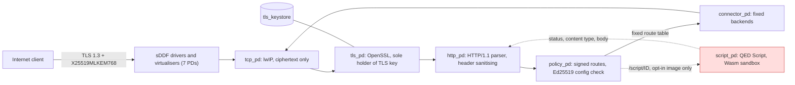

# QEDOS

**The Proof-Oriented Web OS**

*Don't trust the code. Verify what it can do.*

Built for a world where AI writes code faster than humans can audit it.


English | [日本語](README.ja.md)

QEDOS is an experimental, security-focused HTTPS appliance OS built on seL4 and Microkit. It combines mandatory hybrid post-quantum key exchange, capability-isolated components, and sandboxed server-side WebAssembly execution. Its goal is to make security boundaries explicit, minimal, and machine-checkable, even when application code cannot be trusted.

Traditional operating systems try to secure an ever larger and more complex stack. QEDOS explores the opposite direction: reduce the system to the essential capabilities, isolate untrusted components, and verify the boundaries mechanically.

> **Research-stage project.** QEDOS is not an independently audited, production-ready security product. It has only been run under QEMU, never on physical hardware. The sections [Security assurance](#security-assurance) and [Status and limitations](#status-and-limitations) say exactly what is checked, how, and what is not.

## Contents

- [The 30-second version](#the-30-second-version)
- [Architecture](#architecture)
- [Why AI matters](#why-ai-matters)
- [Why QEDOS?](#why-qedos)
- [What makes QEDOS different?](#what-makes-qedos-different)
- [Security assurance](#security-assurance)
- [QED Script](#qed-script)
- [Quick start](#quick-start)
- [Benchmarks](#benchmarks)
- [Status and limitations](#status-and-limitations)
- [Roadmap](#roadmap)
- [Project layout](#project-layout)
- [Contributing](#contributing)
- [License and acknowledgements](#license-and-acknowledgements)
- [Documentation inconsistencies](#documentation-inconsistencies)

## The 30-second version

| Question | Answer |
|---|---|
| What is it? | A single-purpose HTTPS appliance OS: seL4 microkernel, 12 isolated components (13 with the optional script component), TLS termination, fixed-route reverse proxy, optional signed-WebAssembly handlers. |
| Why does it exist? | To test whether an OS can be built so that application code is never trusted: little authority per component, and boundaries that tools can check. |
| vs. Linux? | Linux can also be hardened and can also do post-quantum TLS. QEDOS removes general-purpose features instead of restricting them, and records mechanical checks of the remaining boundaries. It is far less mature (see the comparison table). |
| Technically interesting? | Capability-graph audit of the generated seL4 system, Kani proofs on the parser and policy crates, a Wasm interpreter differentially fuzzed against V8, and an adversarial `script_pd` model for IPC testing. |
| Can I run it? | Yes, under QEMU, including on macOS from a prebuilt image: `python3 tests/test_sel4.py`. See [Quick start](#quick-start). |
| What is verified? | Specific properties of specific components, at stated levels. Most are BOUNDED or TESTED, a few are PROVEN for single functions. See the [assurance table](#security-assurance). |

## Architecture

Logical view; it simplifies shared-memory rings and sDDF driver plumbing. The default image has **12 Protection Domains (PDs)**: 7 sDDF/driver PDs (`timer_driver`, `serial_driver`, `serial_virt_tx`, `ethernet_driver`, `net_virt_rx`, `net_virt_tx`, `tcp_net_copier`) and 5 QEDOS PDs (`tcp_pd`, `tls_pd`, `http_pd`, `policy_pd`, `connector_pd`). The opt-in QED Script image (`QEDOS_SCRIPT=1`) adds `script_pd`, giving **13 PDs**. Counts come from `sel4/meta_proofgate.py` and the generated `build/sel4/proofgate.system` and `build/sel4-script/proofgate.system`.



`script_pd` holds exactly two shared-memory regions (with `policy_pd` and `http_pd`) and two notification channels. It has no mapping of `tls_keystore`, no channel to `tls_pd`, `tcp_pd`, `connector_pd` or any driver, and no IRQ or I/O-port capability. That is checked statically against the artifacts Microkit generates (`scripts/check-script-caps.py`, `scripts/capgraph.py`). It is a check of a model of the system, not a proof about the kernel.

## Why AI matters

AI changes both sides of software security. It makes it much cheaper to generate software, and also cheaper to find vulnerabilities and analyse targets for attack. Trusting the author of the code is therefore no longer a sufficient basis for running it.

QEDOS starts from the assumption that application code may misbehave or be compromised. It restricts the code's authority, and it checks the boundary rather than the code. It is a research project on an execution model for that world, not a demo of AI-generated code, and nothing in it is claimed to be proven safe by an AI.

What can be said about AI involvement in this repository: 6 of its 11 commits carry a `Co-Authored-By: Claude` trailer (`git log`), including the QED Script, capability-graph, IPC-hardening and differential-fuzzer work. All verification claims in this README rest on the recorded tool runs (Kani, Z3, tests, fuzzing logs), not on any AI judgement.

## Why QEDOS?

| Idea | What QEDOS does | Evidence level |
|---|---|---|
| Reduce attack surface | No shell, no SSH daemon, no dynamic admin endpoint in the image; routes are a fixed, Ed25519-signed table. A debug serial console exists in the current (debug) builds. | TESTED (static grep in `scripts/check-laws.sh`, code inspection; `LAW_005`, `LAW_010`) |
| Separate authority per function | One seL4/Microkit PD per function; the TLS private key is mapped only in `tls_pd`. | TESTED (capability audit of generated artifacts) |
| Check conditions, not "prove the OS" | Kani, Z3, a capability-graph checker, ASan harnesses and tests, each on named properties. | See [assurance table](#security-assurance) |
| Post-quantum key exchange | TLS 1.3 with `X25519MLKEM768` only, `TLS_AES_256_GCM_SHA384` only. Defends against "harvest now, decrypt later": recorded traffic stays safe if a quantum computer appears later. | TESTED (`LAW_002`, `LAW_003`) |
| Run untrusted code | Signed Wasm in its own PD with fuel/memory limits and an allow-listed host API. | See [QED Script](#qed-script) |

**Post-quantum scope.** Only the key exchange is post-quantum. Server authentication is classical (the certificate is ECDSA P-256 in the dev setup), so a future quantum adversary able to forge that signature could impersonate the server. No ML-DSA certificates are used.

**Script safety is not OS isolation.** Script safety is what the Wasm sandbox stops a guest from doing. OS isolation is what a fully compromised `script_pd` could still reach; that bound is audited from the capability graph, not proven.

## What makes QEDOS different?

Linux can be configured with strong isolation (namespaces, seccomp, SELinux, VMs, sandboxes) and with post-quantum TLS (for example OpenSSL 3.5+ or a PQC-capable proxy). The table compares defaults and design intent, not what is impossible elsewhere.

| | General-purpose Linux server | Conventional reverse proxy on Linux | QEDOS (this repo) |
|---|---|---|---|
| General-purpose shell | Yes by default; can be removed | Inherits the host | None in the image; debug serial console in current builds |
| Remote administration | Typically SSH | Host's, plus optional admin APIs | None; config is a signed blob, change = new image and reboot |
| Mandatory PQC hybrid key exchange | Configurable | Configurable with a PQC-capable TLS library | Enforced (`X25519MLKEM768` only); authentication is classical |
| Capability-based component separation | Possible (containers, MAC); shared kernel | Process level | seL4 PDs; audited from the generated capability graph |
| Sandboxed server-side execution | Possible (containers, Wasm runtimes) | Usually a module in the proxy process | Signed Wasm in its own PD, no network or key authority |
| Machine-checkable security properties | Mostly testing and audit | Same | Some (Kani, Z3, capability audit); partial |
| Supported hardware | Very broad | Very broad | QEMU only (x86_64, aarch64 `virt`); Raspberry Pi 4 image builds, never booted |
| Operational maturity | Decades, large ecosystem | Decades, production-proven | Research prototype; no audit; single appliance function |

## Security assurance

Levels used in this repository:

| Level | Meaning |
|---|---|
| PROVEN | A prover checked the property for the stated target under stated assumptions; a run record is in the repo. |
| BOUNDED | Bounded model checking (Kani) or a bound-limited proof. Says nothing beyond the bound. |
| TESTED | Automated tests, fuzzing, or a mechanical audit of a model. Shows absence of the failures tried. |
| DESIGNED | Intended by design; no check beyond inspection. |
| UNVERIFIED | Not checked, or only checked on an older version of the code. |

| Property | Level | Evidence and caveats |
|---|---|---|
| HTTP parser in bounds; HTTP/1.1 + Host enforced (`LAW_006`) | BOUNDED | Kani `pg-http` 8/8 harnesses (`build/kani/pg-http.log`); small bounds (N=18..20, 2 headers) |
| Only fixed routes reachable; no traversal (`LAW_001`) | BOUNDED + TESTED | Kani `pg-policy` 3/3 (paths up to 8 bytes); 34 HTTP tests; hostile probes |
| Backend chosen only from fixed table (`LAW_004`) | BOUNDED + TESTED | Kani `pg-policy`; `SEL4_004` |
| Only Ed25519-signed config applied (`LAW_011`) | BOUNDED + TESTED | Kani `pg-config` 2/2; the Ed25519/SHA-512 implementation is UNVERIFIED |
| TLS 1.3 + `X25519MLKEM768` only (`LAW_002/003`) | TESTED | Host and seL4 tests; depends on OpenSSL 3.6.1 being correct |
| TLS key unreachable from HTTP and script layers (`LAW_008`, `LAW_018`) | TESTED (static audit) | Capability audit + image scan. Microkit generates Viper `.vpr` models and the repo pattern-checks them; **Viper itself has never been run**, so no Viper-proven claim is made |
| Minimal capabilities per PD (`LAW_012`, `LAW_014`) | TESTED (static audit) | `check-caps.py`; `check-script-caps.py` (9 weakened systems detected); `capgraph.py` (checks A1-A7, B1, C1-C8 PASS on `build/sel4-script`, D1 kernel-debug check WARN). Checks an extracted model; the model's fidelity is not proven |
| seL4 enforces isolation for this configuration | UNVERIFIED | Assumed. seL4's own proofs are not claimed for this x86_64 Microkit debug configuration and are not transferred to QEDOS |
| Wasm memory range check, `checked_range` (`LAW_013`) | PROVEN for one function; record predates Phase 3 | Kani (all `u32` inputs) + Z3 `range_sound.smt2`. `build/kani/pg-script.log` is dated before the Phase 3 interpreter changes, so a re-run is pending |
| Whole interpreter confined to its memory | TESTED | 60,000-program guard-band fuzz recorded on the pre-Phase-3 interpreter; no whole-interpreter proof; no re-run of that fuzz on the current tree is recorded |
| Wasm semantic conformance | TESTED (differential, not a proof) | `tests/test_wasm_differential.py` vs V8: seed 2, 400,000 cases, 0 disagreements; seed 3, 200,000 cases, 0 disagreements (`build/fuzz/diff-2.json`, `diff-3.json`). Seed 1 (100,000 cases) found 7 disagreements (`diff-1.json`), after which loader fixes were committed; no re-run of seed 1 is recorded. Generator covers a subset; floats, SIMD etc. are only checked to be rejected |
| Host-API confinement (`LAW_015`) | BOUNDED + TESTED | Kani for a one-API policy; 7 hostile-import modules |
| Resource limits (`LAW_016`) | TESTED | No proof. On seL4 the time bound is the fuel bound (no timer client) |
| Only signed scripts run (`LAW_020`) | TESTED | Every single-byte flip of policy and wasm rejected; Ed25519/SHA-512 UNVERIFIED; no anti-rollback; dev key committed |
| Script KV ACL (`LAW_021`) | BOUNDED | 3 Kani harnesses with tiny key bounds + Z3; unusable on seL4 because no authentication exists (all KV calls denied) |
| Shared-memory IPC between PDs against a malicious `script_pd` | TESTED | ASan/UBSan host harnesses `tests/ipc/harness_http.c`, `harness_policy_conn.c` run the real C glue with stubbed Rust; they reproduced bugs on pre-fix code, fixed in `3e77d5d`, `f825d90`. No formal IPC proof |
| End-to-end on seL4 after hardening | TESTED | `test_sel4.py` 6/6 and `test_script_sel4.py` 9/9 on QEMU TCG (`build/script/sel4-default-hardened.log`, `sel4-hardened-3.log`; log files are dated 08:41-08:46, i.e. before the final commit `f825d90`, which is 09:00) |
| Proof-Carrying Script | DESIGNED | Envelope format only; no checker |
| Hardware, release kernel, side channels | UNVERIFIED | Not done or explicitly out of scope |

**Trusted computing base.** The proxy path trusts: the hardware; the seL4 kernel binary and its build configuration; Microkit's tool, monitor and CapDL initialiser; sDDF drivers and lwIP; OpenSSL 3.6.1 (including its ML-KEM and X25519 code) and the freestanding libc shim; the C glue in the PDs (`sel4/pds/*.c`); the Rust crates `pg-http`, `pg-policy`, `pg-config`; the pure-Rust Ed25519/SHA-512 in `pg-config`; the compiler and toolchain. Script requests add `script_pd`, `pg-script`, `pg-script-policy`, `pg-script-verify` and the C-ABI shim. None of the third-party libraries, the compiler or the hardware is verified here. Side channels are excluded from every claim.

Details: [docs/SECURITY.md](docs/SECURITY.md), [docs/LAWS.md](docs/LAWS.md), [docs/THREAT_MODEL.md](docs/THREAT_MODEL.md), [docs/CAPABILITY_AUDIT.md](docs/CAPABILITY_AUDIT.md), [docs/STATUS.md](docs/STATUS.md).

## QED Script

Run untrusted code without trusting it. QED Script executes **signed WebAssembly** in `script_pd` (lowest application priority) on routes `GET|POST /script/<module>`.

| Control | What it is | Level |
|---|---|---|
| Host API allow-list | 8 functions in module `qs`: `req_method`, `req_field`, `resp_status`, `resp_content_type`, `resp_write`, `kv_get`, `kv_put`, `kv_delete`. No WASI, network or filesystem; unknown imports refused at load. | BOUNDED + TESTED |
| Limits | Fuel, linear memory, stack depth, request/response size, host calls; set in the signed policy, capped by platform ceilings (1 MiB memory, 5e7 fuel, 64 KiB bodies). | TESTED |
| Signed modules | Ed25519 over wasm + policy + runtime id + proof digest, using a code-signing key separate from the config key. **The development seed is committed (`config/keys/qs-code-signing-seed.hex`); never trust it in a deployment.** | TESTED |
| No TLS key, no network authority | See [Architecture](#architecture). | TESTED (audit) |
| Engine | Purpose-built interpreter (`crates/pg-script`, `no_std`, `forbid(unsafe_code)`, no heap), a WebAssembly subset. The current tree supports i32/i64, globals, tables and `call_indirect`, `br_table`, `memory.grow` and bulk copy/fill; floats, SIMD, threads, WASI, multi-value are rejected. No Rust/TinyGo SDK exists yet. | see assurance table |

**Hello World**, from `examples/hello/build.py` (assembled with `tools/qswasm.py`, no Wasm toolchain needed):

```python
BODY = b'{"message":"Hello from QEDOS"}'
m = Module(memory_pages=1)
m.import_func("resp_status", 1, 0)
m.import_func("resp_content_type", 1, 0)
m.import_func("resp_write", 2, 0)
m.data.append((0, BODY))
m.func("handle", 0, 1, 0, f"""
i32.const 200
call $resp_status
i32.const 0          ;; application/json
call $resp_content_type
i32.const 0
i32.const {len(BODY)}
call $resp_write
i32.const 0
end
""", export="handle")
```

Its signed policy is `examples/hello/app.policy` (`allow = resp_status`, `allow = resp_content_type`, `allow = resp_write`, `max_fuel = 10000`, `max_memory_bytes = 65536`, ...). Run it with the `qs` CLI as shown in the [Quick start](#quick-start).

### Proof-Carrying Script

| Exists today | Research goal, not built |
|---|---|
| `app.proof` envelope (`QSPF1`) is parsed and bound to the exact wasm and policy bytes; its SHA-512 is covered by the signature. `proof_accepted()` is a constant `false`; the only admission mode is `SignedSandboxed`. A proof is never a reason to run code or relax limits. | A small independent proof checker; certificate formats for claims such as `FuelBounded`, `HostApiSubset`, `MemorySafe`; a mechanised link between the checker's Wasm semantics and the interpreter. Design notes: [docs/SCRIPT_VERIFICATION.md](docs/SCRIPT_VERIFICATION.md). |

More: [docs/QED_SCRIPT.md](docs/QED_SCRIPT.md), [docs/SCRIPT_SECURITY.md](docs/SCRIPT_SECURITY.md), [docs/SCRIPT_RESULTS.md](docs/SCRIPT_RESULTS.md).

## Quick start

"5 minutes" is a goal for the prebuilt-image path on a machine that already has the prerequisites, not a measured guarantee. A macOS (Apple Silicon) run of these steps is recorded in [docs/TEST_REPORT.md](docs/TEST_REPORT.md); QEMU boot took about 10 s in the recorded Linux runs.

**Prerequisites:** `git`, `python3`, QEMU (`qemu-system-x86_64`), Rust (`cargo`), and an OpenSSL command-line client of version 3.5 or later (needed for `X25519MLKEM768` on the client side; Python's `ssl` linked to OpenSSL 3.0.x cannot offer it).

```sh
brew install qemu openssl@3 rust
git clone https://github.com/shi3z/qedos.git && cd qedos

# Boot the prebuilt 12-PD image in QEMU and run the 6 end-to-end PQC HTTPS tests
python3 tests/test_sel4.py

# Run a QED Script example on the host (pure Rust, no seL4)
scripts/qs-ws.sh build --release -p pg-script-cli
build/qs/ws/target/release/qs run examples/hello      # prints status/body: {"message":"Hello from QEDOS"}

# Verify the negotiated post-quantum key exchange: boot with tools/run-echo.sh, then
OPENSSL_CONF=config/openssl-min.cnf openssl s_client -connect 127.0.0.1:18443 -tls1_3 -groups X25519MLKEM768
# expect: Negotiated TLS1.3 group: X25519MLKEM768
```

The committed prebuilt image is the default 12-PD one; the 13-PD QED Script image on seL4 needs the full Linux toolchain build. The exact boot command, the full build from source, all test and verification suites, and aarch64 are in **[docs/BUILD.md](docs/BUILD.md)**.

## Benchmarks

Only numbers recorded in `docs/RESULTS.md` and `docs/SCRIPT_RESULTS.md`. They come from different machines and runs and are not directly comparable. The Wasm microbenchmarks predate the Phase 3 interpreter and have not been re-measured.

### Host Reference Implementation (Linux `pg-proxy`, not seL4)

Environment (`docs/RESULTS.md`): 24-core Linux host, loopback, client + proxy + backends on one machine, single-threaded proxy, OpenSSL 3.6.1.

| Test | Result |
|---|---|
| PERF_001/002: 10,000 held TCP / TLS 1.3 `X25519MLKEM768` connections | 0 failures; RSS 9.6 MB (TCP), about 27.8 KB per TLS connection (peak 285 MB) |
| PERF_004: 10 % active, 20 s | about 13.4 k req/s, 0 errors |
| PERF_006: handshake storm | about 5.4 k handshakes/s on one core |

A later re-run (`docs/SCRIPT_RESULTS.md`, on the machine used for the QED Script work; the note there says the figures above came from other hardware) gave PERF_004 8.2 k req/s and PERF_006 2.6 k handshakes/s; PERF_008 could not run there because the Python test client lacked the PQC group. Latency percentiles in the load tool are log2-bucket upper bounds with the client sharing the CPU.

**Host Wasm microbenchmark** (not HTTPS; `qs bench`, release build, one thread, no TLS or network; 24-core x86-64 Linux host, `docs/SCRIPT_RESULTS.md`): Hello World 180,322 req/s (5.6 us, 9 fuel); KV counter 174,669 req/s; JSON echo with 1000-byte body 2,681 req/s (373 us, 62,229 fuel). Not comparable to proxy req/s.

### QEMU seL4 Implementation (QEMU TCG emulation, no KVM)

Environment: Ubuntu 22.04 host, 30 sequential end-to-end HTTPS requests each with a fresh PQ-TLS handshake, two runs (`docs/SCRIPT_RESULTS.md`, `build/script/sel4-latency.jsonl`). Emulator-bound; says nothing about hardware speed.

| Request | Median latency |
|---|---|
| `GET /health` (default image) | 83.0 / 82.7 ms |
| `GET /health` (script image) | 82.8 / 82.4 ms |
| `GET /script/hello` | 83.2 / 84.1 ms |
| `POST /script/json-echo` (500-byte body) | 85.0 / 88.0 ms |

Boot to ready: 10.3-10.8 s (default), 11.3 s (script image).

### Native Hardware

**None measured.** No physical-hardware run of any kind has been performed.

## Status and limitations

| Area | Current state |
|---|---|
| Hardware | Never run on physical hardware. Raspberry Pi 4 image builds and passes the capability audit but was never booted. No bare-metal x86 boot path ([docs/X86_BAREMETAL_PLAN.md](docs/X86_BAREMETAL_PLAN.md) is a plan). |
| NIC | virtio-net (QEMU) only; no real NIC driver. |
| Entropy | x86_64: `RDRAND` mixed with the TSC (CPUID-guarded; QEMU needs `+rdrand`); quality on real hardware not assessed. aarch64: predictable development placeholder; do not expose to an untrusted network ([docs/AARCH64.md](docs/AARCH64.md)). |
| Kernel build | Images use Microkit `--config debug`. The debug kernel exposes capability-less syscalls (halt, console output) to every PD, including a compromised `script_pd`. `capgraph.py` check D1 reports WARN. No release-kernel image has been built or tested. |
| Formal verification | Partial. Kani covers listed pure-Rust crates and functions with small bounds. Viper models are generated but Viper was never run. The Kani/Z3 records for `pg-script` predate Phase 3. seL4's proofs are not transferred. |
| Wasm conformance | Subset interpreter. Differential testing against V8 recorded (see assurance table); not a proof; not a spec-testsuite run. |
| Proof checker | Not implemented. |
| Script concurrency | One script request in flight; others get 503. The seL4 TLS front end has 4 connection slots (`PG_MAX_CONNS`), far below the 10,000-connection capacity of the Linux reference proxy. |
| PD failure recovery | No PD restart or watchdog exists. If `script_pd` faults, Microkit leaves it stopped; TLS, `/health` and proxying continue (tested, `SCRIPT_009`) and `/script/*` returns 503 until reboot. Behaviour when any other PD faults is not tested or documented, and no recovery mechanism exists. |
| Script time bound | On seL4, fuel only; `script_pd` has no timer client, so `max_exec_us` is enforced on the host runtime only. |
| Key management | Dev TLS cert/key (`config/dev/`), config signing key and QED Script signing seed (`config/keys/`) are in the repo. No key rotation, revocation, HSM, or provisioning design. No Secure Boot work. |
| Rollback prevention | None. Script versions are signed but not compared with stored state; configs have no version counter. |
| Authentication | TLS server authentication is classical (ECDSA P-256); there is no user authentication layer, so script KV is unusable on seL4 and lives inside `script_pd`, not a Storage PD. |
| Side channels | Out of scope (cache, timing, speculative execution); a compromised `script_pd` shares the CPU with `tls_pd`. |
| Operational features | None: no logging pipeline, metrics, remote configuration, live reload, upgrade mechanism, or hardened serial console. Configuration change means building and booting a new signed image. |
| Audit | No independent security audit. |

## Roadmap

Everything here is an open item or a research goal, not a capability. Items already implemented are not listed.

| # | Goal | Where it stands now |
|---|---|---|
| 1 | Formal verification of capability and IPC | Partial, not formal: capability-graph audit (`scripts/capgraph.py`, Z3 Datalog on the extracted model, mutation self-test) and IPC ASan harnesses. Viper never run; no IPC proof. |
| 2 | Wasm interpreter conformance | Partial: V8 differential fuzzing, 600,000 recorded zero-disagreement cases (seeds 2, 3) plus 100,000 with 7 findings that led to fixes. No spec-testsuite run, no proof, subset only. |
| 3 | Full-compromise isolation tests for the Script PD | Partial: capability audit, adversarial `script_pd` in host IPC harnesses, crash injection (`SCRIPT_009`). No test with real attacker native code executing inside `script_pd` on seL4 is recorded. |
| 4 | Proof checker for Proof-Carrying Script | Not started; envelope only. |
| 5 | Physical x86-64 hardware | Not started; plan only. |
| 6 | Production key management and Secure Boot | Not started; dev keys committed. |
| 7 | C10K on real hardware | Not started. C10K exists only for the Linux reference proxy; the seL4 appliance has 4 connection slots. |
| 8 | Third-party audit | Not started. |

Also open: release-kernel image, PD restart policy, timer-based script budget on seL4, authentication and a separate Storage PD, re-running Kani/Z3 and the full suites on the current tree.

## Project layout

| Path | Contents |
|---|---|
| `crates/pg-http`, `pg-policy`, `pg-config` | `no_std`, `forbid(unsafe_code)` parser, routing policy, signed-config verification (Kani-checked) |
| `crates/pg-proxy`, `pg-load` | Linux reference proxy, C10K load tool |
| `crates/pg-script`, `pg-script-policy`, `pg-script-verify`, `pg-script-cli` | QED Script interpreter, policy/KV, bundle verification, `qs` CLI (incl. fuzz generator) |
| `sel4/` | Microkit system generator (`meta_proofgate.py`), PD sources (`pds/*.c`), shared-memory header (`include/pg_shm.h`), Rust FFI PDs, libc shim |
| `scripts/` | Builds, capability audits (`check-caps.py`, `check-script-caps.py`, `capgraph.py`), `check-laws.sh` |
| `security/cap-policy.json` | Reviewed intended authority per PD |
| `tests/` | TLS, HTTP, seL4, script, perf suites; `tests/ipc/` ASan harnesses; Wasm differential harness |
| `proofs/smt/` | Z3 models |
| `examples/` | `hello`, `json-echo`, `params`, `kv-counter`, `malicious/` |
| `build/kani`, `build/perf`, `build/script`, `build/fuzz`, `build/sel4` | Recorded evidence and the prebuilt default image |
| `docs/` | Architecture, status, laws, security, threat model, build guide |

## Contributing

Reviews are most welcome from seL4 developers, formal-verification researchers, Rust security engineers, WebAssembly implementers, cryptography engineers, OS developers and security auditors. Concrete review targets:

| Target | Where | Question |
|---|---|---|
| Capability graph correctness | `scripts/capgraph.py`, `security/cap-policy.json`, [docs/CAPABILITY_AUDIT.md](docs/CAPABILITY_AUDIT.md) | Does the extracted model match what the CapDL initialiser and kernel actually build? Are the checks complete? |
| Shared-memory IPC trust boundaries | `sel4/pds/*.c`, `sel4/include/pg_shm.h`, `tests/ipc/` | Is every length, index and state read from shared memory clamped and snapshotted? |
| Wasm interpreter conformance | `crates/pg-script`, `tests/test_wasm_differential.py` | Spec deviations, validator laxness, arithmetic panics. |
| Proof checker soundness | Not implemented; design in [docs/SCRIPT_VERIFICATION.md](docs/SCRIPT_VERIFICATION.md) | Review the requirements before any checker is written. |
| Microkit MCS verification assumptions | [docs/THREAT_MODEL.md](docs/THREAT_MODEL.md) | Does any seL4 proof configuration cover x86_64 + MCS + this build? |

Security issues: [docs/SECURITY.md](docs/SECURITY.md) describes the guarantees and limits, but **no private vulnerability-reporting channel is documented yet** (there is no root `SECURITY.md`, and no contact is published in the repo). Until one is added, please do not post unpublished serious vulnerabilities in public issues; contact the maintainer through the GitHub profile of the repository owner and ask for a private channel first. Everything else (bugs, questions, review notes): open an issue.

## License and acknowledgements

`Cargo.toml` declares `Apache-2.0` for the workspace, but there is currently **no `LICENSE` file** in the repository. Components under `third_party/` (OpenSSL, sDDF, Microkit SDK) carry their own licenses.

Built on [seL4](https://sel4.systems/), [Microkit](https://github.com/seL4/microkit), [sDDF](https://github.com/au-ts/sddf), [lwIP](https://savannah.nongnu.org/projects/lwip/), [OpenSSL](https://www.openssl.org/), [Rust](https://www.rust-lang.org/), and checked with [Kani](https://github.com/model-checking/kani) and [Z3](https://github.com/Z3Prover/z3). Using them does not imply their endorsement or that their verification results apply to QEDOS.

## Documentation inconsistencies

Where repository documents disagree with the code or each other, this README follows the code and recorded logs. Known cases (the other documents are unchanged):

- `docs/RESULTS.md` says seL4 results used Microkit 2.1.0; everything else and the build use 2.3.1.
- `docs/RESULTS.md` says Viper "proves" `LAW_008`/`LAW_012`; `docs/SCRIPT_VERIFICATION.md` and `docs/SCRIPT_RESULTS.md` say Viper was not run.
- `docs/QED_SCRIPT.md` and `docs/LAWS.md` (`LAW_013`) say `memory.grow`, i64, tables and globals are rejected; the code now implements them. `examples/malicious/cases.py` still expects `memory_grow` to be rejected.
- `docs/QED_SCRIPT.md` section 2 says conformance is untested against a reference engine; differential runs against V8 are now recorded.
- `docs/SECURITY.md` links to absolute paths of a different checkout.
- `docs/THREAT_MODEL.md` and `docs/CAPABILITY_AUDIT.md` refer to `SECURITY_ASSURANCE.md`, `IPC_VERIFICATION.md` and `HARDENING_RESULTS.md`, which do not exist.
- `docs/CAPABILITY_AUDIT.md` says the debug kernel is "detected"; the recorded `capgraph` result for check D1 is WARN.
